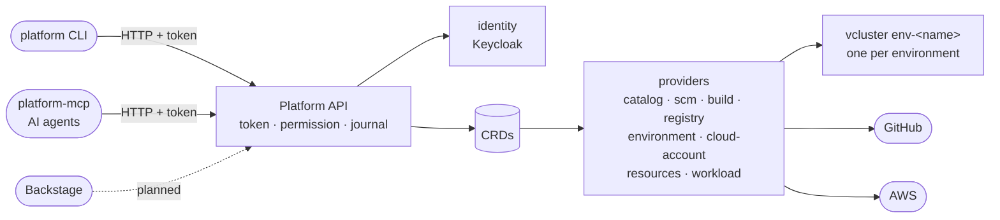

# wasp-idp

[](https://github.com/smsilva/wasp-idp/actions/workflows/pages.yaml) [](LICENSE)

An internal developer platform built around the **Platform API**: it runs environments, the catalog, builds and deploys. The `platform` CLI and an AI agent over MCP (`platform-mcp`) are two ways to use it.

**Guide:** https://smsilva.github.io/wasp-idp/platform/ · [Walkthrough](https://smsilva.github.io/wasp-idp/platform/walkthrough/) · [Demos](https://smsilva.github.io/wasp-idp/platform/demo/) · [Reference](https://smsilva.github.io/wasp-idp/platform/reference/) · [Deck](https://smsilva.github.io/wasp-idp/#present-1)

## What the Platform API does

The API is the platform. The CLI and the MCP server send the same requests, with the same login, and get the same answers: only the API decides what a person may do, so an agent never gets more than the person it acts for ([ADR 0027](docs/adr/0027-machine-access-and-mcp-server.md)). The API writes custom resources; one provider per subsystem reconciles them into vclusters, GitHub repositories and builds, or AWS accounts. `platform status` lists each capability, its provider and whether it works ([ADR 0039](docs/adr/0039-capabilities-computed-from-deployments.md)).



Subsystems and their dependencies: [ADR 0034](docs/adr/0034-platform-subsystems.md). The full picture: [Architecture](https://smsilva.github.io/wasp-idp/platform/architecture/).

## Quickstart

Everything runs locally in `platform-local` (k3d). Check the [prerequisites](https://smsilva.github.io/wasp-idp/platform/walkthrough/bootstrap/prerequisites/) (Docker, k3d 5.9.0 or newer, kubectl, uv), then, from the root of this checkout:

```bash
make all
```

Installs `platform` and `platform-mcp` on the `PATH`. Write the settings once, with your e-mail as the admin:

```bash
platform init \
  --admin you@example.com \
  --generate-file
```

Start the control plane (Google sign-in is [optional](https://smsilva.github.io/wasp-idp/platform/walkthrough/bootstrap/google-credentials/); without it, sign-in works with a password):

```bash
platform init
```

Sign in and see what the platform can do:

```bash
platform login
platform status
```

From here, the [walkthrough](https://smsilva.github.io/wasp-idp/platform/walkthrough/) goes on one step per page: teams, catalog, templates, SCM connection, components, builds, registry, environments, workloads, cloud accounts, agents and cleanup.

## See it in action

| What | Link |
|---|---|
| AI agent: questions in plain language, through the MCP server | [MCP demo](https://smsilva.github.io/wasp-idp/platform/demo/mcp/) |
| The developer journey with the CLI (`scripts/demo/cleanup` removes what it creates) | [CLI demo](https://smsilva.github.io/wasp-idp/platform/demo/cli/) |
| IDP deck, in present mode (arrows navigate, `Esc` goes back to the index) | https://smsilva.github.io/wasp-idp/#present-1 |
| Deck, straight to the journey "from idea to running product" | https://smsilva.github.io/wasp-idp/#present-journey-plan |
| Deck, straight to the full landscape: clients, Platform API and the five planes | https://smsilva.github.io/wasp-idp/#present-landscape-full |

Deck links use the slide `name` in `docs/presentation/idp.yaml` (`#present-<name>`), which does not change when slides are added or removed before it; `#present-<N>` also works, but points to step N. The deck and the Platform API guide are published to GitHub Pages by `.github/workflows/pages.yaml` on every push to `main`.

## Documentation map

| If you want to... | Go to |
|---|---|
| Use the platform with the CLI, step by step | [`platform/docs/walkthrough/`](platform/docs/walkthrough/) ([published](https://smsilva.github.io/wasp-idp/platform/walkthrough/)) |
| Look up a CLI command, an MCP tool or the API | [`platform/docs/reference/`](platform/docs/reference/) ([published](https://smsilva.github.io/wasp-idp/platform/reference/)) |
| Run a demo | [`platform/docs/demo/`](platform/docs/demo/) ([published](https://smsilva.github.io/wasp-idp/platform/demo/)) |
| See how clients, API and providers fit together | [`platform/docs/architecture.md`](platform/docs/architecture.md) |
| See architecture decisions already taken (ADRs) | [`docs/adr/README.md`](docs/adr/README.md) |
| Understand the AWS reference architecture (hub-and-spoke, domains) | [`aws/docs/README.md`](aws/docs/README.md) |
| Provision the AWS platform (Terraform, sequence, roots) | [`aws/terraform/README.md`](aws/terraform/README.md) |
| Use or develop Backstage (IDP) | [`docs/idp/README.md`](docs/idp/README.md) |
| Edit the IDP deck (single deck, YAML source) | [`docs/presentation/README.md`](docs/presentation/README.md) |
| See the history of what was delivered | [`docs/archived/README.md`](docs/archived/README.md) |
| Understand why a past decision was taken, or reread an old plan | [`docs/superpowers/README.md`](docs/superpowers/README.md) |
| Resume where the last session stopped | board #6: `scripts/board/queue next` and the issue it points to |

## What's new

Each change lands as a pull request that closes its issue: see the [merged pull requests](https://github.com/smsilva/wasp-idp/pulls?q=is%3Apr+is%3Amerged+sort%3Aupdated-desc) and the [closed issues](https://github.com/smsilva/wasp-idp/issues?q=is%3Aissue+is%3Aclosed+sort%3Aupdated-desc).

## Repo conventions

- `CLAUDE.md` in each folder = rules for whoever edits there. `README.md` in each folder = index of what exists. Never duplicate the same content in both.
- One document covers one subject; when a section goes too deep into a subtopic, it becomes a file of its own, referenced from where it made sense.
- Before renaming any `.md` file, run `scripts/bin/check-doc-links`.
