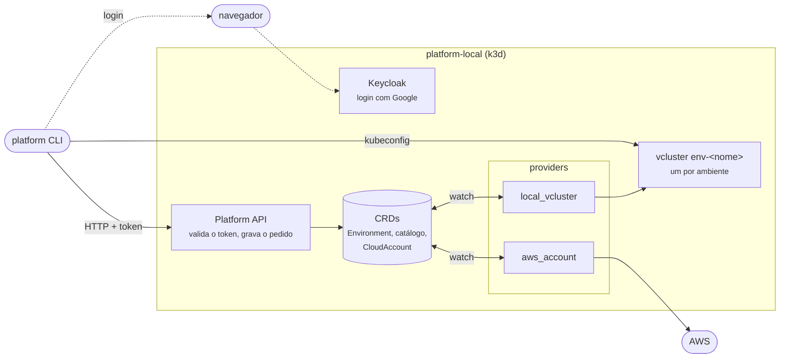

---
hide:
  - navigation
---

# platform CLI

Sobe um control plane local e cria Environments, cada um como um cluster Kubernetes virtual (vcluster) dentro dele.

Clique no diagrama para ampliar.

A CLI só fala com a Platform API, que grava cada pedido como um recurso Kubernetes (CRD). Os providers observam esses recursos e fazem o trabalho: criar o vcluster ou falar com a AWS. Tudo roda dentro do `platform-local`, instalado pelo `init`; não há processo para manter aberto no host.

## Passo a passo

1. [Pré-requisitos](guide/01-prerequisites.md)
2. [Instalar a CLI](guide/02-install.md)
3. [Subir o control plane](guide/03-control-plane.md)
4. [Entrar](guide/04-login.md)
5. [Criar um ambiente](guide/05-create-environment.md)
6. [Usar o cluster do ambiente](guide/06-use-environment.md)
7. [Saída em JSON](guide/07-json-output.md)
8. [Apagar](guide/08-delete.md)
9. [Expiração](guide/09-expiration.md)
10. [Por baixo: o CRD](guide/10-crd.md)
11. [Catálogo](guide/11-catalog.md)
12. [Times](guide/12-teams.md)
13. [Contas de nuvem](guide/13-cloud-accounts.md)
14. [Desmontar tudo](guide/14-teardown.md)

## Referência rápida

| Comando | O que faz |
|---|---|
| `platform init --target local [--admin <email>] [--aws-profile <profile>]` | cria `platform-local`, CRDs, Keycloak, Platform API e o provider `local_vcluster`; com credencial AWS, também o `aws_account` |
| `platform login [--use-device-code]` | entra com a conta Google |
| `platform whoami` | e-mail e grupos, vistos pela API |
| `platform logout` | revoga a sessão e apaga as credenciais |
| `platform environment create <nome> --profile ephemeral\|shared [--expires 3d] [--share-with <time>]... [--wait]` | pede um ambiente, privado se não compartilhado |
| `platform environment list [--all]` | NAME, PROFILE, STATUS, EXPIRES, OWNER, SHARED; os seus e os dos seus times, ou todos |
| `platform environment share\|unshare <nome> --team <time>` | compartilha ou deixa de compartilhar; só o dono ou `platform-admins` |
| `platform environment get <nome> [--admin]` | status e mensagem; grava o seu kubeconfig quando pronto, ou o de administrador (só `platform-admins`) |
| `platform environment credential <nome>` | token de 10 minutos como `ExecCredential`; quem chama é o kubectl, pelo kubeconfig |
| `platform environment delete <nome>` | remove o ambiente e o vcluster; só o dono ou `platform-admins` |
| `platform catalog domain create <nome> --owner <time> [--parent <domínio>]` | cria um domínio ou subdomínio (só `platform-admins`) |
| `platform catalog system create <nome> --domain <domínio> --owner <time>` | cria um sistema |
| `platform catalog resource create <nome> --type <papel> --system <sistema> --owner <time>` | cria um recurso compartilhado |
| `platform catalog list [--kind domain\|system\|resource] [--owner <time>]` | KIND, NAME, PARENT, OWNER |
| `platform catalog <kind> list\|get\|delete` | por kind; `get` mostra os dependentes |
| `platform catalog import <caminho>... [--repo <url> --ref <ref>] [--dry-run] [--yes]` | importa Domain, System, Resource e Template de arquivos Backstage, depois de revisar o plano |
| `platform team list\|get <time>` | times e membros |
| `platform team create\|delete <time>` | cria ou apaga um time (só `platform-admins`) |
| `platform team member add\|remove <time> <email>` | muda membros (só `platform-admins`); vale no próximo `platform login` |
| `platform catalog template list\|get <nome>` | NAME, TYPE, REF, DEFAULT, SOURCE; `get` mostra os parâmetros |
| `platform catalog template create <nome> --type <tipo> --owner <time> --repo <url> --path <pasta> --ref <ref> [--default]` | registra um template (só `platform-admins`) |
| `platform catalog template import <caminho> --repo <url> --ref <ref> [--dry-run] [--yes]` | importa templates do Backstage ou do formato da plataforma |
| `platform catalog template default\|delete <nome>` | muda o padrão do tipo; apaga (só `platform-admins`) |
| `platform catalog template render [<nome>\|--from <pasta>] --name <component> --output <pasta> [--param k=v]` | renderiza localmente |
| `platform cloud account add <nome> --role-arn <arn> [--region <região>]...` | registra uma conta AWS e imprime a trust policy |
| `platform cloud account list\|get <nome>` | NAME, VENDOR, ACCOUNT, STATUS, VALIDATED (OWNER para admins); `get` mostra a trust policy |
| `platform cloud account verify <nome> [--wait]` | pede ao provider uma nova verificação |
| `platform cloud account remove <nome>` | tira a conta da plataforma; só o dono ou `platform-admins` |
| `--output json` | em todos os comandos |

| Status | Significado |
|---|---|
| `NoProviderForCapability` | nenhum provider assumiu o pedido |
| `Provisioning` | vcluster sendo criado |
| `ready` | vcluster no ar; `get` ou `--wait` gravam o kubeconfig |
| `ProvisioningFailed` | erro do provider; veja `message` no JSON |
| `deleting` | remoção em andamento |

| Porta | Uso |
|---|---|
| `6560` | Kubernetes API do `platform-local` |
| `127.0.0.1:9090` | Platform API |
| `localhost:8180` | Keycloak (issuer `http://localhost:8180/realms/platform`) |
| `127.0.0.1:7100`–`7119` | API de cada ambiente (vcluster), uma porta por ambiente |
