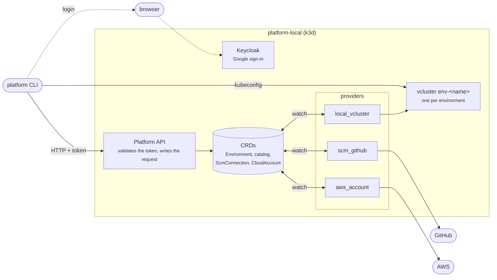

---
hide:
  - navigation
---

# platform CLI

Brings up a **local control plane** and creates **Environments**, each one a virtual Kubernetes cluster (**vcluster**) inside it.

Click the diagram to enlarge it.

The CLI only talks to the **Platform API**, which writes each request as a Kubernetes resource (**CRD**). The **providers** watch those resources and do the work: create the vcluster, talk to GitHub or AWS. Everything runs inside `platform-local`, installed by `init`; **there is no process to keep open on the host**.

## Where to start

-   :material-play-circle-outline: **[Walkthrough](walkthrough/index.md)**

    ---

    Learn by doing: from an empty machine to an environment running, a catalog, teams, a cloud account and a GitHub connection, one step per page, with the real output of each command.

-   :material-book-open-variant: **[Reference](reference/index.md)**

    ---

    Look up a command: flags, status values, permissions, ports and what happens under the hood.

