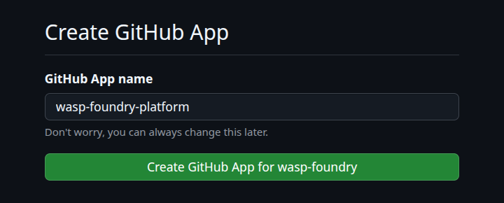

# Create the App

The connection tells the platform **which org to create repos in** and **with which credential** (ADR 0025). Only `platform-admins` manage it.

``` { .text .plan title="what will be created" }
wasp-foundry                connection · the default
└── wasp-foundry-platform   GitHub App of the wasp-foundry org, on all repositories
```

=== "New App, via the browser"

    The `add` opens the browser at the Platform API, which sends the **manifest** of the `<org>-platform` App to GitHub. GitHub returns the key **straight to the platform**, without passing through the machine of whoever runs the command.

    ```bash
    platform scm connection add wasp-foundry \
      --vendor github \
      --org wasp-foundry \
      --default
    ```

    ``` { .text .output title="output" }
    → opening the browser to create the GitHub App "wasp-foundry-platform" …
    ✓ app created (id 5274859) · private key stored by the platform
    → install it on the org: https://github.com/apps/wasp-foundry-platform/installations/new
      then run: platform scm connection verify wasp-foundry --wait
    ```

    On GitHub, whoever confirms must be an **org owner**. Name and permissions already come from the manifest: just confirm at **Create GitHub App for wasp-foundry**.

    { .screenshot loading=lazy width="540" }

    !!! tip
        `--no-browser` only prints the URL, to open on another machine. It is **single-use** and valid for **10 minutes**; running `add` again issues another.

=== "Existing App"

    Goes in without a browser, using the key downloaded from GitHub. The key goes to the platform and is **not kept** in `~/.config/platform`.

    ```bash
    platform scm connection add wasp-foundry \
      --vendor github \
      --org wasp-foundry \
      --app-id 123456 \
      --private-key-file wasp-foundry-platform.private-key.pem \
      --wait
    ```

!!! warning "A cluster recreated from scratch"
    The `<org>-platform` App lives on GitHub, not in the cluster: after `k3d cluster delete`, it is still there and its private key is gone with the cluster. A new `add` through the browser then fails on GitHub with **Name is already taken**. Either delete the App (org **Settings → GitHub Apps → wasp-foundry-platform → Advanced → Delete GitHub App**) and run `add` again, or keep it: generate a new private key on its page (**Private keys → Generate a private key**) and go in with **Existing App**, adding `--default`.
