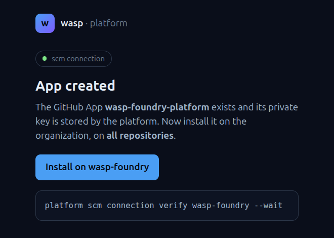
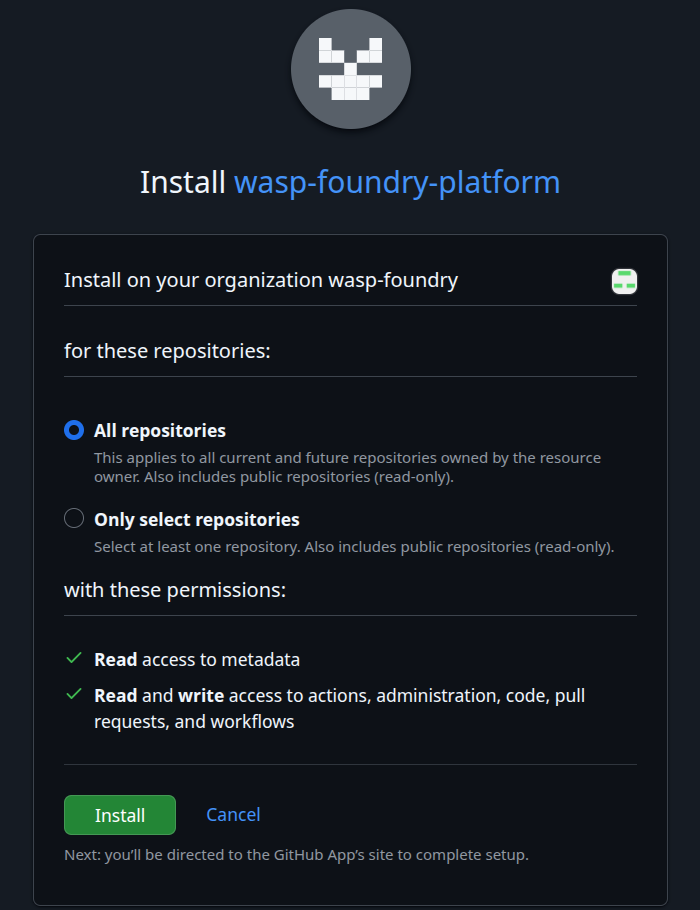

# Install on the org

GitHub returns to the platform, which leads to the installation:

{ .screenshot loading=lazy width="500" }

Install on **All repositories**; the permissions are those of the manifest:

{ .screenshot loading=lazy width="500" }

Until then, the connection stays `NotInstalled`, and `get` shows the link:

```bash
platform scm connection get wasp-foundry
```

``` { .text .output title="output" }
wasp-foundry (default): NotInstalled
  the App wasp-foundry-platform is not installed on wasp-foundry: https://github.com/apps/wasp-foundry-platform/installations/new
  vendor:       github
  org:          wasp-foundry
  app:          wasp-foundry-platform (id 5274859)
  install:      https://github.com/apps/wasp-foundry-platform/installations/new
```
