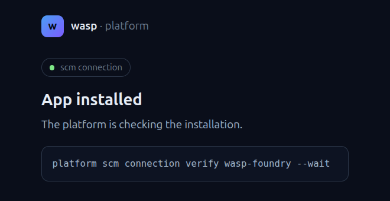

# Verify the GitHub connection

After the installation, GitHub returns to the "App installed" page, which **already requests the verification**:

{ .screenshot loading=lazy width="500" }

```bash
platform scm connection verify wasp-foundry \
  --wait

platform scm connection list
```

``` { .text .output title="output" }
✓ wasp-foundry ready (wasp-foundry, all repositories)
→ register its GHCR, where builds of wasp-foundry repos push: platform registry add ghcr-wasp-foundry --scm-connection wasp-foundry --default
NAME          VENDOR  ORG           STATUS  DEFAULT  VALIDATED
wasp-foundry  github  wasp-foundry  ready   yes      2026-10-11T14:52:26Z
```
