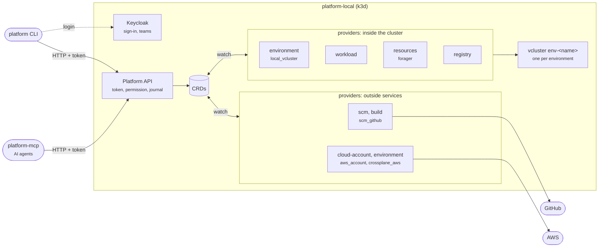

---
hide:
  - navigation
---

# Architecture

The **Platform API** is the platform. The CLI and the MCP server are two of its clients: they send the same requests, with the same login, and get the same answers. Only the API decides what a person may do, so an agent never gets more than the person it acts for (ADR 0027).

Click the diagram to enlarge it.

- **Clients.** The CLI covers the whole platform; the MCP server exposes it as tools for AI agents, read-only unless started with `--allow-writes`. Both use the login of `platform login`.
- **Platform API.** Validates the Keycloak token on every `/v1/*` route, checks the permission (owner, team, `platform-admins`), writes the request as a CRD and records it in the journal, with the person who asked.
- **Providers.** Each one implements a capability: it watches its CRDs, does the work (a vcluster, a GitHub workflow, an AWS account, a database for a workload) and writes the result back as conditions. `platform status` lists each capability and the provider behind it.

Everything runs inside `platform-local`, installed by `platform init`; **there is no process to keep open on the host**. [Under the hood](reference/under-the-hood.md) shows the CRDs, the journal and the ports.
