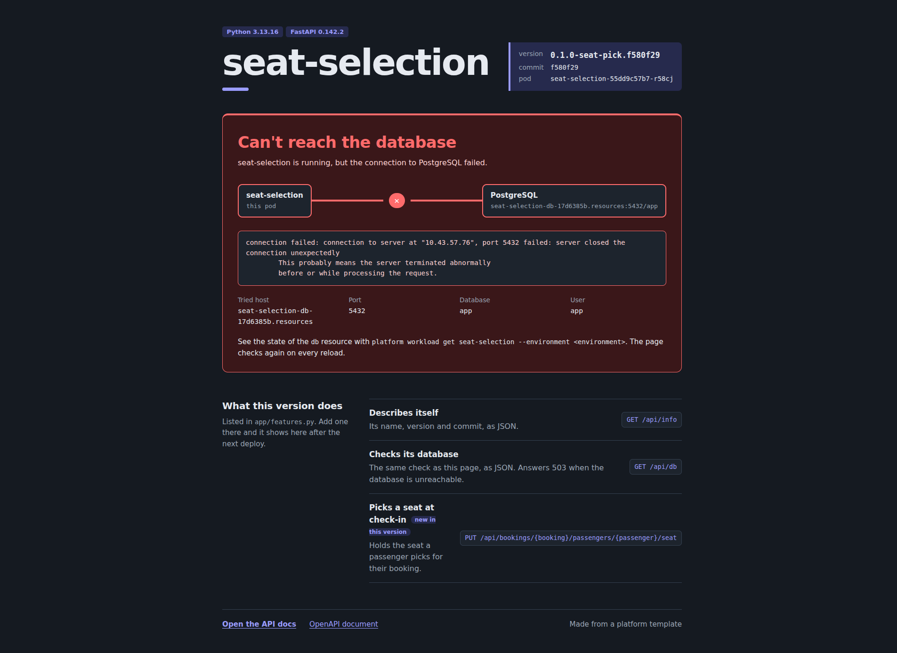

# See the app without it

Reload [http://seat-selection.demo.localhost:7080/](http://seat-selection.demo.localhost:7080/):

{ .screenshot loading=lazy width="700" }

```bash
curl http://seat-selection.demo.localhost:7080/api/db
```

``` { .text .output title="output" }
{"status":"failed","host":"seat-selection-db-17d6385b.resources","port":5432,"database":"app","user":"app","error":"connection failed: ... server closed the connection unexpectedly ...","details":true}
```

`/api/db` answers `503`; `/healthz` stays `200`, so the pod is not restarted.
